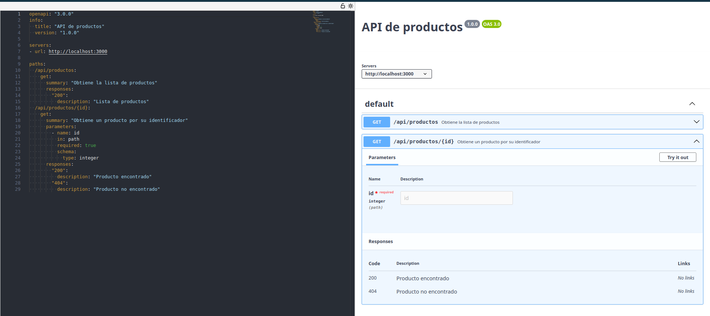

# API de productos

## OpenAPI

OpenAPI es una especificación estándar para describir APIs HTTP. Permite documentar sus rutas, parámetros y respuestas en un formato que pueden entender tanto las personas como distintas herramientas.

## Swagger UI

Swagger UI es una interfaz web que muestra una especificación OpenAPI de forma interactiva. Sirve para consultar la documentación y probar las peticiones desde el navegador. En esta aplicación las rutas están implementadas, pero Swagger UI no está configurado ni disponible como página.

## Endpoints

### `GET /api/productos`

Devuelve todos los productos en formato JSON. Cada producto incluye `id`, `nombre` y `precio`.

### `GET /api/productos/{id}`

Devuelve en JSON el producto cuyo identificador coincide con `id`. Si no existe, responde con estado `404` y el mensaje `{"error":"Producto no encontrado"}`.

## Captura de la documentación visualizada

