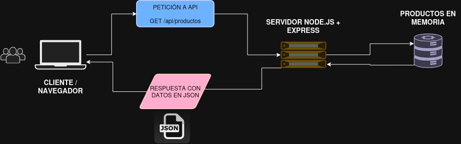

# Arquitectura y procesos

## Proceso escrito

1. El cliente realiza una petición.
2. El servidor la procesa y la traduce, para enviarla a la base de datos.
3. La base de datos recoge los datos necesarios y los envía al servidor.
4. El servidor procesa los datos recibidos, lo convierte a formato JSON y los envía al cliente.
5. El cliente lee los resultados.
